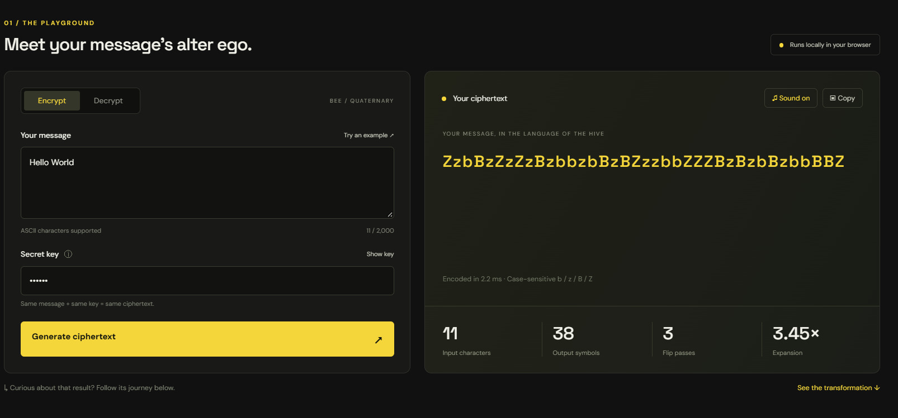
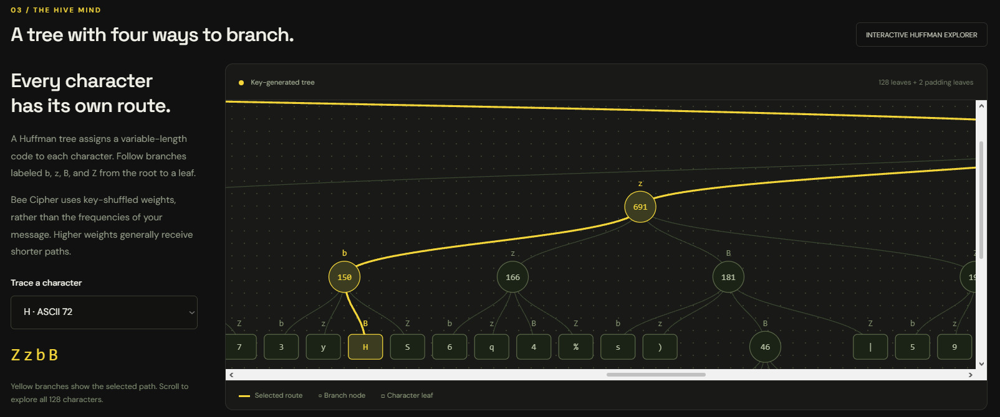

# Bee Cipher

An interactive website showcasing our custom-made Bee Cipher, with encryption, decryption, step-by-step explanations, and a Huffman tree visualizer.

## About the Project

Bee Cipher began as a project for **Information Assurance and Security 2 (IT129)**. We later updated and improved it for **Applied Cryptography (IT190-4P)** as part of our **Cybersecurity specialization** at **Mapúa Malayan Colleges Laguna**.

The project explores how key-dependent encoding and positional symbol substitutions work together in a custom symmetric cipher. Alongside the Python implementation and research study, we developed this website to make the algorithm easier to understand through hands-on simulation and visual explanations.

## About the Study

Our study, **“Bee Cipher: A Comparative Analysis and Cryptanalytic Evaluation of a Morse-Inspired Positional Inversion Substitution Scheme,”** evaluates Bee Cipher against Caesar, monoalphabetic substitution, and Vigenère ciphers.

Bee Cipher transforms ASCII plaintext into four symbols—`b`, `z`, `B`, and `Z`—using a key-dependent Huffman codebook, followed by positional substitution passes derived from the key. The study examines output entropy, sensitivity to changes in the key and plaintext, encryption and decryption runtime, and ciphertext expansion.

The reported results show a near-balanced output-symbol distribution and greater sensitivity to key changes than plaintext changes. The study also identifies tradeoffs, including longer ciphertext and limited plaintext diffusion. These observations support further experimentation; they do not establish the security of the design for sensitive real-world data.

**The full research paper is not included in this repository.** Its publication is managed separately by the authors.

## Website Preview

[Explore the Bee Cipher website([https://raileytimple-dev.github.io/bee-cipher/)]

### Encryption Simulator

Enter a message and secret key to generate ciphertext and inspect the output length, flip passes, and expansion ratio.



### Interactive Huffman Tree

Select an ASCII character to highlight its route through the four-branch tree and view its codeword.



## Features

- **Encryption and decryption:** Enter a message and secret key to try the cipher.
- **Step-by-step walkthrough:** Follow key scheduling, codebook construction, encoding, interval derivation, and positional substitution passes.
- **Interactive Huffman tree:** Select a character to trace its codeword from the root to its leaf.
- **ASCII codebook:** Browse the codes assigned to all 128 ASCII characters.
- **Generation animation:** See a yellow waveform for one second before ciphertext appears.
- **Bee sound:** Play a one-second bee recording during generation, with a sound toggle.
- **Research summary:** Read the study’s comparison results, limitations, and proposed future work.

## How Bee Cipher Works

1. **Schedule the key:** Hash the complete key with SHA-256 and use the resulting seed to shuffle the ASCII alphabet deterministically.
2. **Build the codebook:** Assign weights based on the shuffled order and construct a four-branch Huffman tree.
3. **Encode the message:** Replace each character with its codeword over `b`, `z`, `B`, and `Z`.
4. **Derive the intervals:** Convert key characters into unique interval values and generate a key-dependent symbol cycle.
5. **Apply the passes:** Substitute every nth symbol according to each interval and the symbol cycle.

Decryption reconstructs the same tree, reverses the substitution passes, and traverses the tree to recover the message.

## Run Locally

The website is built with **HTML, CSS, and JavaScript**. No build step or package installation is required.

1. Download and extract the source, or clone this repository.
2. Open a terminal in the folder containing `index.html`.
3. Start a local server:

```bash
python -m http.server 8000
```

4. Open **http://localhost:8000** in your browser.

If your Windows installation uses the Python launcher, run `py -m http.server 8000` instead. Use localhost or HTTPS for Web Crypto support.

## Project Structure

```text
.
├── index.html              # Website content and interface
├── style.css               # Responsive styling and animations
├── app.mjs                 # Simulator controls and visualizations
├── cipher.mjs              # Bee Cipher implementation
├── buzz.mjs                # Bee audio playback and preferences
├── assets/                 # Bee audio and animation assets
├── docs/screenshots/       # Website screenshot folder
└── README.md
```

## Implementation Notes

- The JavaScript cipher was checked against **85 compatibility cases** from the supplied Python implementation, including complete ASCII codebooks and decryption.
- Plaintext and keys are limited to ASCII. As in the Python decoder, recovered ASCII control characters display as `?`.
- The same plaintext and key produce the same ciphertext.
- Benchmark figures shown on the website are reported study results, not live measurements of the visitor’s message or device.
- Bee Cipher is an educational custom cipher. Use established authenticated encryption for sensitive information.

## Researchers

- **Ingrid Breanna Cabrera**
- **John Railey Timple**
- **Alvert Paul Verzosa**

College of Computer and Information Science  
Mapúa Malayan Colleges Laguna  
Cabuyao City, Philippines
